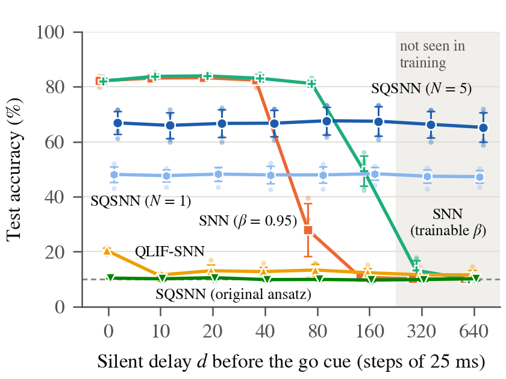

# sqsnn-recall

The experiments test whether a spiking neural network still knows which digit it has seen after a
silent delay. A stochastic quantum spiking neural network (SQSNN) [1] with the proposed event-gated read
ansatz is compared with SQSNNs with other ansätze, an SNN of quantum leaky integrate-and-fire (QLIF)
neurons [2] (QLIF-SNN) and classical SNNs of LIF neurons. Every network has about 1.85 × 10⁵ trainable parameters. All networks are trained with
surrogate gradients and backpropagation through time. The SQS neurons are simulated exactly as
statevectors, with single-shot sampling of their spikes.

## Task: delayed MNIST-DVS classification

* **Input.** A network has 708 input lines. 676 lines carry the 26 × 26 pixels of an MNIST-DVS
  recording [3], binned into 20 frames of 25 ms. The other 32 lines carry a go cue.
* **Silent delay.** After the 20 frames, the network receives `d` steps without any input event.
* **Response.** The go lines then spike at every step of a response window of 5 steps. The predicted
  class is the output neuron with the most spikes in this window, and ties are broken at random.
* **Delays.** Each training batch draws `d` from {0, 10, 20, 40, 80, 160}, so the network must hold the
  class until the go cue, whenever it arrives. Testing uses these delays and also 320 and 640, which are
  never seen in training.
* **Data split.** The 9000 training recordings are split once, with a fixed seed, into 8000 for training
  and 1000 for validation. The test set holds the other 1000 recordings. Each run is tested at the epoch
  with the highest validation accuracy, averaged over the training delays, and its test accuracy is
  averaged over 3 passes through the test set (`--test_reps`).

## Models

| `--model` | neuron |
|---|---|
| `sqs_event` | SQS neuron with the proposed event-gated read ansatz. `--n_mem N` sets the number of memory qubits. |
| `sqs_chen` | SQS neuron with the original ansatz [1], with one memory qubit |
| `sqs_read` | original ansatz plus a controlled X rotation from the memory qubit to the IO qubit (variant from an earlier draft) |
| `qlif` | QLIF neuron [2], with the `AlphaSurrogate` function of [deanbrand/QSNN](https://github.com/deanbrand/QSNN) copied verbatim (MIT license, notice in `models.py`) |
| `lif` | LIF neuron with the leak factor `--beta` (0.95 by default, 1 gives an IF neuron) and the update of snnTorch `Leaky` [4] |
| `lif_lb` | LIF neuron with a trainable leak factor for each neuron, initialised at 0.95 |

Every network has one hidden layer. `hidden_for_budget` in `models.py` picks the hidden width whose
number of trainable parameters is closest to the budget, so the hidden widths differ between neurons.

In the event-gated read ansatz, the input rotation of the input-output (IO) qubit is split into two
halves. Between them, the IO qubit controls an X rotation (write) of each memory qubit, and each memory
qubit controls a Z rotation (read) of the IO qubit. An X rotation of each memory qubit ends the step.
Without an input event, the IO qubit stays in |0⟩. The read gates then only add phases to the memory
qubits, the neuron does not spike, and the memory state changes only by a fixed unitary transformation.

## Setup

```bash
git clone https://github.com/SpikingJ/sqsnn-recall.git
cd sqsnn-recall
conda create -n sqsnn python=3.10 -y
conda activate sqsnn
pip install torch==2.5.1 --index-url https://download.pytorch.org/whl/cu121
pip install -r requirements.txt
```

The code was run with Python 3.10.19 and torch 2.5.1+cu121 on NVIDIA A100 GPUs (driver 535). On a GPU,
the SQS step is compiled with `torch.compile`, and `--compile 0` turns this off.

## Data

The MNIST-DVS data is not part of this repository.

1. Download the MNIST-DVS recordings [3] from
   <http://www2.imse-cnm.csic.es/caviar/MNISTDVS.html>.
2. Convert the scale-4 recordings to `mnist_dvs_events.hdf5` with
   `neurodata/preprocessing/process_mnistdvs.py` of [kclip/neurodata](https://github.com/kclip/neurodata),
   which needs `pip install tables`. The script keeps pixels 48 to 73 in each direction (26 × 26). It
   puts recordings 1 to 900 of each digit in the training set and recordings 901 to 1000 in the test set.
3. Bin the events into frames:
   ```bash
   python prep_mnist_dvs.py --src /path/to/mnist_dvs_events.hdf5
   ```
   This writes `data/mnist_dvs_T20.npz` (about 11 MB), which `train.py` reads.

If another machine already has `data/mnist_dvs_T20.npz`, copying that file is enough.

## Running

SQSNN with the proposed ansatz and N = 5 memory qubits per neuron:

```bash
python train.py --model sqs_event --n_mem 5 --delays 0,10,20,40,80,160 --extra_test_delays 320,640 \
    --epochs 50 --lr 5e-4 --surrogate ste --write_max 0.5 --read_min 0.25 --gain0 0.1
```

QLIF-SNN:

```bash
python train.py --model qlif --delays 0,10,20,40,80,160 --extra_test_delays 320,640 \
    --epochs 50 --lr 5e-4 --gain0 0.1
```

Classical SNN of LIF neurons with the leak factor 0.95 (`--model lif_lb` trains one leak factor per neuron):

```bash
python train.py --model lif --delays 0,10,20,40,80,160 --extra_test_delays 320,640 \
    --epochs 50 --loss sum_spk --go_init 0
```

Each run writes the test accuracy at every delay to `results/`. The job lists `jobs/main.txt` and
`jobs/main_m5.txt` hold all runs of the figure below, with 5 seeds per network, and
`python runner.py jobs/main.txt --logdir logs/main --gpus 0` runs such a list in parallel.

## Results



Test accuracy against the silent delay `d` before the go cue, in steps of 25 ms, for networks with about
1.85 × 10⁵ trainable parameters. Each curve shows the mean ± s.d. over 5 runs, and the dots show the
single runs. The dashed line marks chance, and the shaded delays are not seen in training. The original
ansatz is that of [1].

## References

[1] J. Chen, B. Rajendran, and O. Simeone, "Stochastic quantum spiking neural networks with quantum
memory and local learning," *IEEE J. Sel. Areas Commun.*, vol. 44, pp. 5421–5436, 2026,
doi: [10.1109/JSAC.2026.3714333](https://doi.org/10.1109/JSAC.2026.3714333).

[2] D. Brand and F. Petruccione, "A quantum leaky integrate-and-fire spiking neuron and network,"
*npj Quantum Inf.*, vol. 10, no. 1, Art. no. 125, Dec. 2024,
doi: [10.1038/s41534-024-00921-x](https://doi.org/10.1038/s41534-024-00921-x).

[3] T. Serrano-Gotarredona and B. Linares-Barranco, "Poker-DVS and MNIST-DVS. Their history, how they
were made, and other details," *Front. Neurosci.*, vol. 9, Art. no. 481, Dec. 2015,
doi: [10.3389/fnins.2015.00481](https://doi.org/10.3389/fnins.2015.00481).

[4] J. K. Eshraghian *et al.*, "Training spiking neural networks using lessons from deep learning,"
*Proc. IEEE*, vol. 111, no. 9, pp. 1016–1054, Sep. 2023,
doi: [10.1109/JPROC.2023.3308088](https://doi.org/10.1109/JPROC.2023.3308088).
